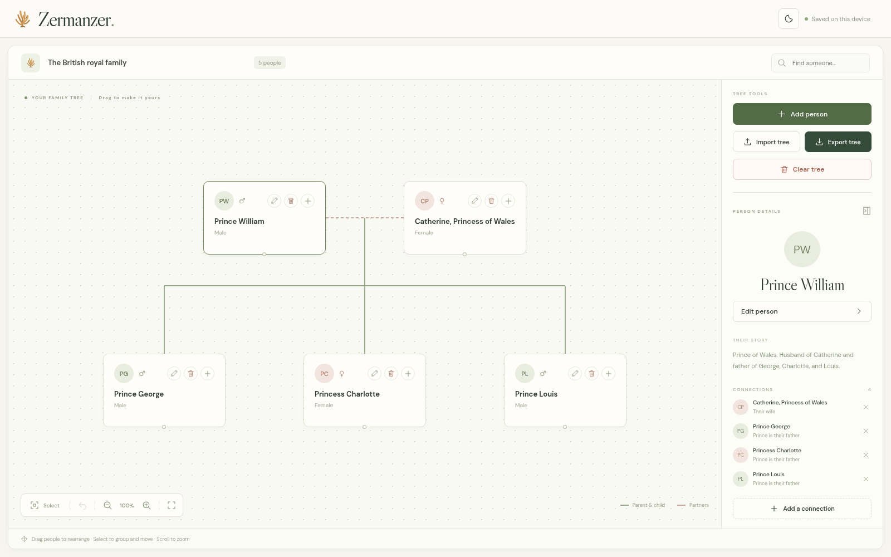

# Zermanzer

A family tree editor built with React and TypeScript. No account or database needed.

[Try the app](https://aamir2020.github.io/family-tree-generator/)



## Features

- Add, edit, and delete people and family connections.
- Connect parents, children, and partners. Sibling relationships are shown automatically.
- Drag people, move groups, and scroll to zoom.
- Import and export trees as JSON files.
- Search people, undo changes, and switch between light and dark mode.

## Getting started

Install Node.js 22.12 or later, then run:

```bash
git clone https://github.com/Aamir2020/family-tree-generator.git
cd family-tree-generator
npm ci
npm run dev
```

Open the local URL printed in the terminal, usually `http://localhost:5173`.

## Usage

Click **Add person** to start. Click **+** on a person to add a relative or connect someone already in the tree. Select a person to edit their details in the sidebar.

Use **Select** to draw a selection box and move several people together. **Import tree**, **Export tree**, and **Clear tree** are in the sidebar.

New visitors see a British royal family example: William, Catherine, and their three children. Relationships are based on the [Royal Family’s official biography](https://www.royal.uk/the-prince-of-wales).

## Development

| Command           | Purpose                                       |
| ----------------- | --------------------------------------------- |
| `npm run check`   | Check formatting, lint, types, and tests      |
| `npm run format`  | Format files with Prettier                    |
| `npm test`        | Run tests                                     |
| `npm run build`   | Type-check and build the website into `dist/` |
| `npm run preview` | Preview the production build locally          |

Application code is in `src/`, tests in `tests/`, and README images in `docs/images/`.

## Data and privacy

Your tree is saved in this browser only. Other visitors cannot see it. Export a JSON backup before clearing browser data or switching devices.

Imports support Zermanzer JSON files only; GEDCOM and other services’ formats are not supported.
