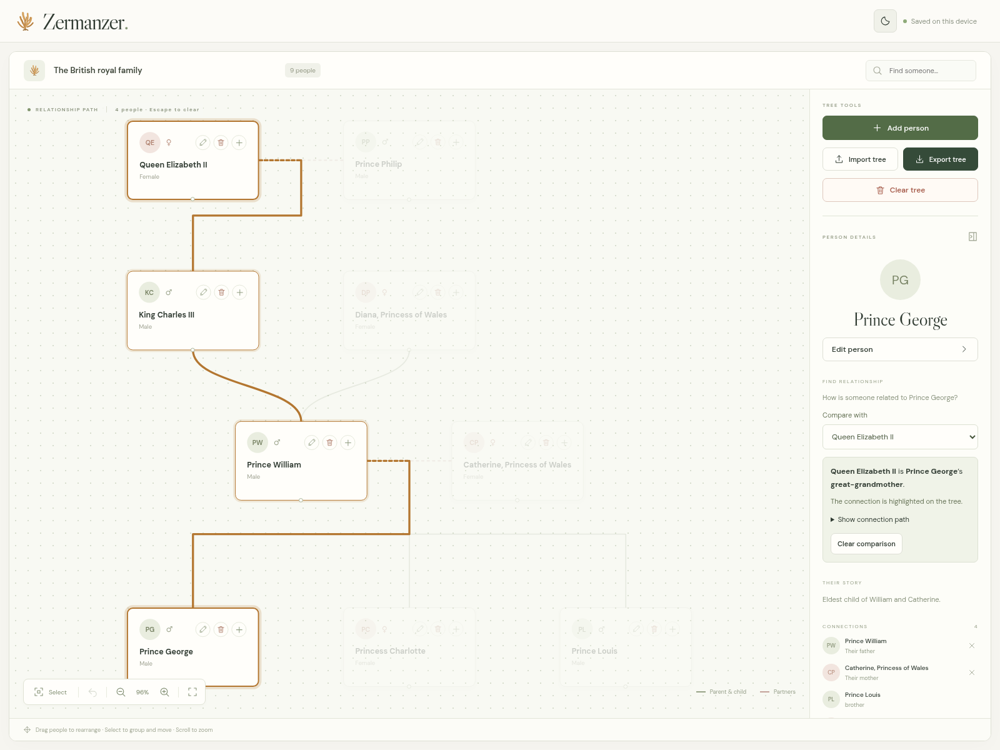

# Zermanzer

A family tree editor built with React and TypeScript. No account or database needed.

[Try the app](https://aamir2020.github.io/family-tree-generator/)



## Features

- **People:** Add, edit, and delete people. Birthdays and notes are optional.
- **Connections:** Link new or existing parents, children, and partners. Checks prevent duplicate parents, duplicate connections, and ancestry loops.
- **Parent prompts:** When adding a child or partner, optionally connect the other parent or existing children.
- **Relationship finder:** Identify ancestors, descendants, siblings, cousins and removals, step-relatives, and in-laws. Show the connection path and flag missing information.
- **Path highlighting:** Trace connecting people and lines in gold while fading the rest.
- **Canvas:** Drag people and groups, pan, zoom, and fit the tree on screen. Shared children branch from the couple’s line.
- **Files:** Import validated JSON backups and export with a filename you choose. Confirm before replacing a tree.
- **Editing:** Remove connections, confirm person deletion and clearing the tree, and undo the last 30 tree changes during the session.
- **Search and themes:** Highlight names and switch between light and dark mode. The initial theme follows your system preference.

## Getting started

Install Node.js 22.12 or later, then run:

```bash
git clone https://github.com/Aamir2020/family-tree-generator.git
cd family-tree-generator
npm ci
npm run dev
```

Open the local URL printed in the terminal, usually `http://localhost:5173`.

## Usage

Select a card to open its details. Use its pencil, trash, or **+** button to edit, delete, or add a relative. File tools are in the right sidebar.

| Action              | How                                                                                                                    |
| ------------------- | ---------------------------------------------------------------------------------------------------------------------- |
| Compare people      | Select someone under **Find relationship → Compare with**. Use **Clear comparison** or Escape to clear the highlight.  |
| Move a group        | Click **Select**, drag a rectangle, then drag a selected card. Shift adds to the selection; Escape clears it.          |
| Navigate            | Drag empty canvas to pan, scroll to zoom, or click **Fit tree**.                                                       |
| Remove a connection | Click its line or the × in person details. Shared child lines remove both parent links; person details can remove one. |

The sample spans four generations of the British royal family, from Elizabeth II and Philip to William’s children.

## Development

| Command           | Purpose                                       |
| ----------------- | --------------------------------------------- |
| `npm run check`   | Check formatting, lint, types, and tests      |
| `npm run format`  | Format files with Prettier                    |
| `npm test`        | Run tests                                     |
| `npm run build`   | Type-check and build the website into `dist/` |
| `npm run preview` | Preview the production build locally          |

Application code is in `src/`, tests in `tests/`, and README images in `docs/images/`.

## Data and privacy

Your tree is saved in this browser only. Other visitors cannot see it. Export a JSON backup before clearing browser data or switching devices.

Imports support Zermanzer JSON files only; GEDCOM and other services’ formats are not supported.
